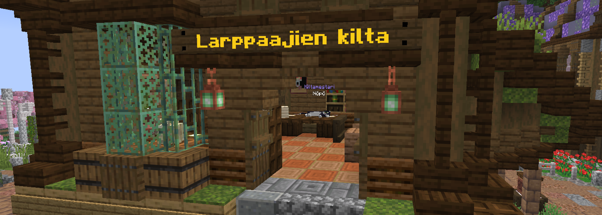
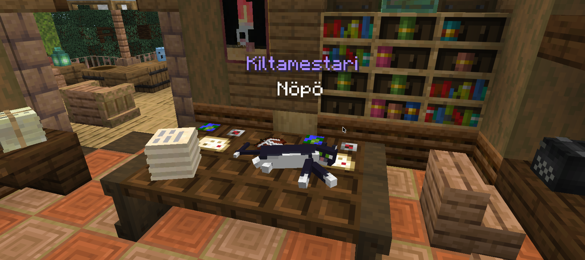
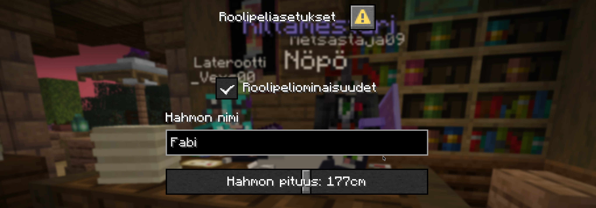
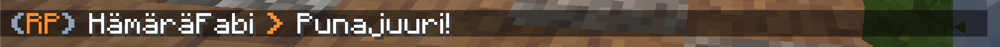

**Larppaajien kilta** spawnilla on keskitetty paikka säätää kaikkia roolipeliasetuksia.
Saat roolipeliasetukset näkyviin puhumalla kiltamestarille.

Asetuksista saat otettua roolipeliominaisuudet käyttöön sekä vaihdettua oman hahmon nimeä ja pituutta.
Hahmon nimi on käytössä roolipelichatissa.

Roolipeliominaisuudet voi myös ottaa käyttöön / poistaa käytöstä milloin tahansa komennolla `/rp`.

## Roolipelichat
Roolipelichat näkyy **100 palikan säteellä** niille pelaajille, jos he ovat ottaneet itselleen roolipelauksen käyttöön.
Kirjoitus chattiin onnistuu komennolla `/rpchat <viesti>`.

### /me -komento
Tavallisen roolipelichatin lisäksi on myös `/me <toiminta>` -komento, jonka avulla voi ilmaista tekevänsä jotain tiettyä toimintaa omana hahmonaan.
Kuten roolipelichat, tämä näkyy **100 palikan säteellä** niille pelaajille, joilla on roolipeliominaisuudet käytössä.

