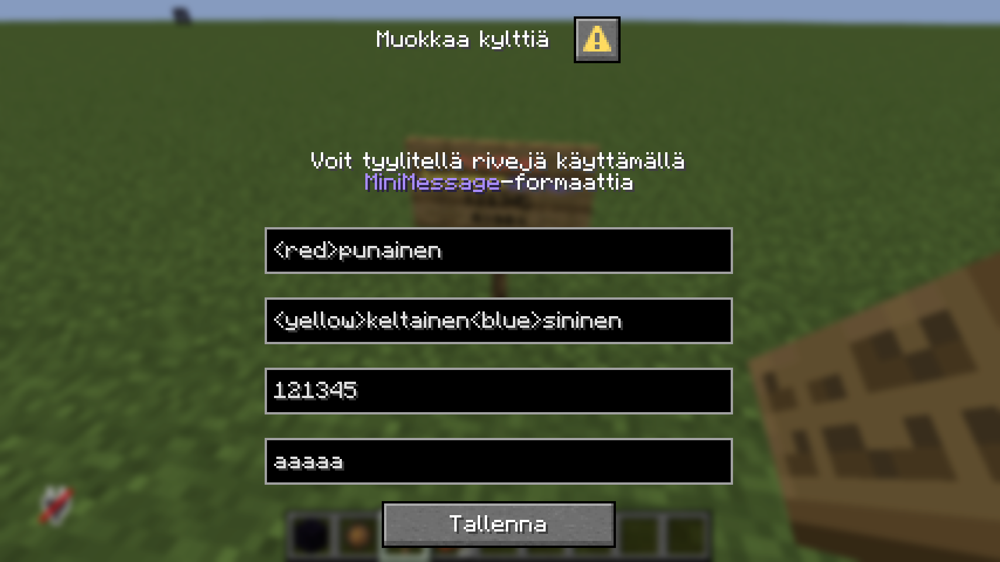

## Chat
Chatissa voi käyttää [MiniMessage](/miscellaneous/minimessage)-formaatin värikoodeja. Huomioithan, että vain **väri**, **pride** ja **väriliuku** tägit ovat käytettävissä chatissa.

## Kyltit
Yksittäisiä kyltin rivejä on mahdollista tyylitellä `/sign`-komennolla. Jokainen rivi tukee [MiniMessage](/miscellaneous/minimessage)-formaattia jonka avulla tyylittely tapahtuu.

## Asennot
Komento | Kuvaus
--- | ---
`/sit` | Istu (melkein) missä vain huvittaa
`/lay` | Makaa selälläsi
`/crawl` | Ryömi
`/spin` | Pyöri kuin hyrrä
`/legsup` | Pyllistä tyylillä
